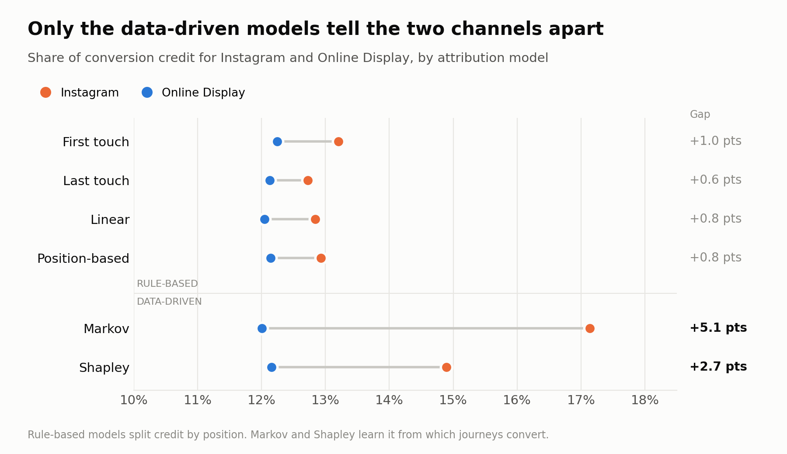
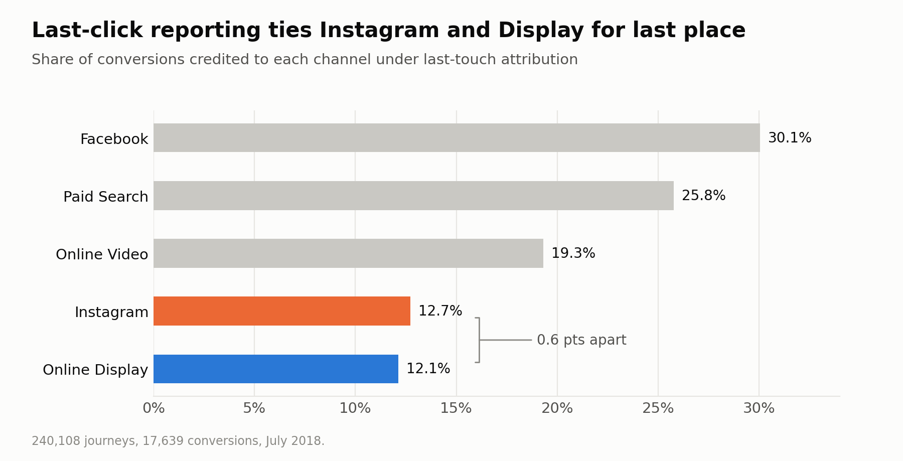
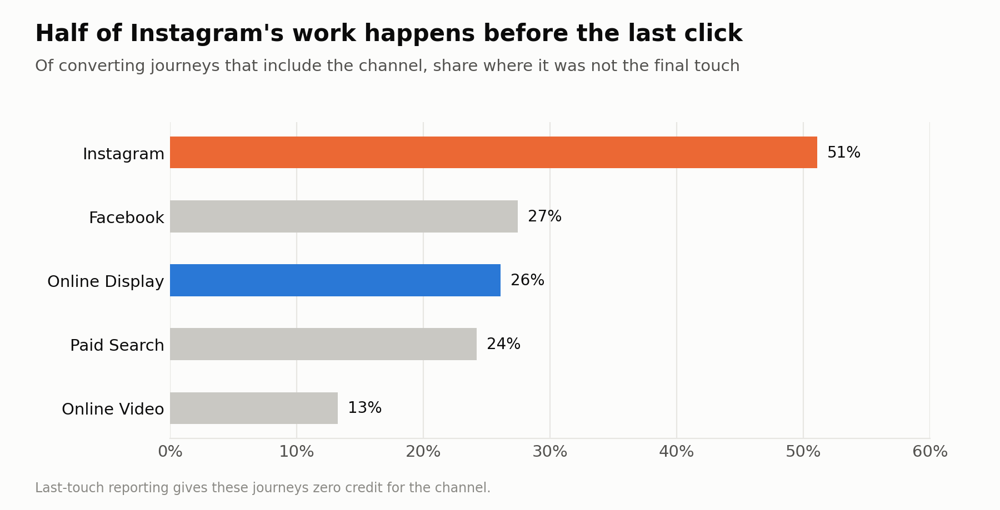
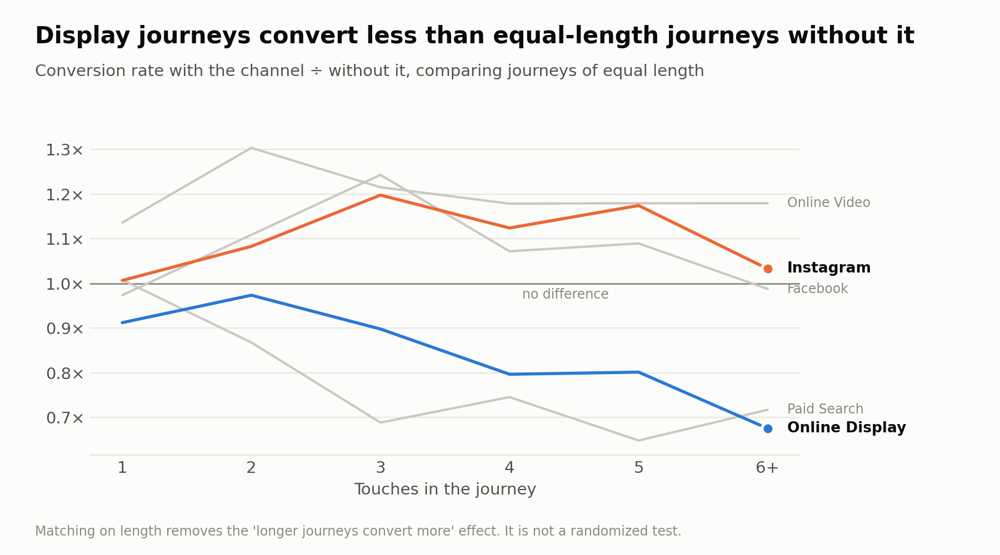
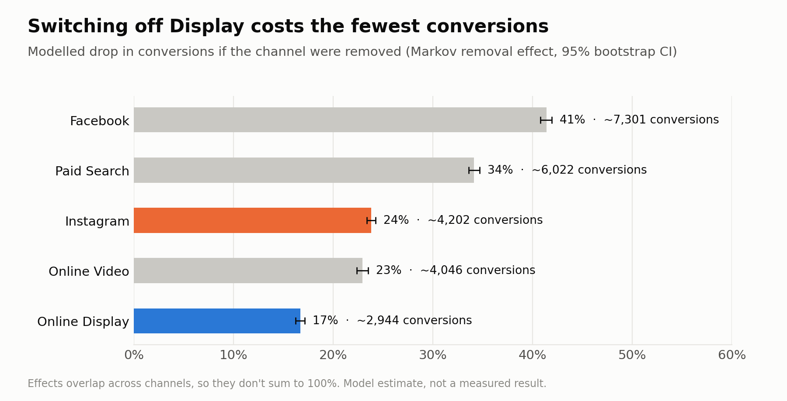

# Two channels, one cut

**Multi-touch attribution on 240,108 customer journeys: which ad channel can you cut without losing the conversions you didn't know it was driving?**



## The decision

A paid-media budget is shrinking and one channel's line item goes on the cut list. The last-click dashboard says Instagram (12.7% of conversions) and Online Display (12.1%) are tied for last place, so cutting either looks equally safe.

This project tests whether that tie is real or an artifact of how last-click assigns credit.

## The answer

**Cut Display, not Instagram, and confirm it with a holdout test.**

| | Instagram | Online Display |
|---|---|---|
| Last-touch credit | 12.7% | 12.1% |
| Markov credit (95% CI) | **17.1%** (16.8–17.4) | 12.0% (11.7–12.3) |
| Shapley credit (95% CI) | **14.9%** (14.5–15.3) | 12.2% (11.7–12.6) |
| Converting journeys where it assisted but didn't close | **51%** | 26% |
| Conversion lift vs. equal-length journeys without it | 1.01× to 1.20× | **0.68× to 0.97×** |
| Modelled conversions lost if removed | ~4,200 | **~2,900** |

- **The tie only exists under rule-based models.** First-touch, last-touch, linear and position-based all keep the two within 1 point. Both data-driven models separate them: Instagram earns 5.1 points more than Display under Markov (95% CI 4.6–5.6) and 2.7 more under Shapley (2.0–3.4).
- **Last-click can't see half of Instagram's work.** In 51% of the converting journeys Instagram is part of, it isn't the final touch, about double every other channel. Display behaves like the rest: when it's present, it usually closes, so last-click already counts it.
- **Display journeys finish less often.** At every journey length, journeys that include Display convert worse than journeys of the same length without it (down to 0.68× for long journeys). Instagram's are equal or better.
- **Removing Display costs the least.** In the Markov model, Display's removal costs about 2,900 conversions; Instagram's about 4,200.

### Recommendation

1. Put **Online Display** on the cut list.
2. **Test before cutting.** Pause Display in a matched set of regions for 4–6 weeks and compare total conversions with control regions. The model's upper bound is a ~17% drop in the paused regions; the test measures how much of that is real.
3. **Report Instagram on Markov credit or assist share**, not last-click, or it will keep looking like a cut candidate.

## The evidence, in order

| | |
|---|---|
|  |  |
|  |  |

Full walkthrough with every table: [`notebooks/attribution_story.ipynb`](notebooks/attribution_story.ipynb)

## Models

| Type | Model | How credit is assigned |
|---|---|---|
| Rule-based | First touch / Last touch | 100% to the first / final touch |
| | Linear | Split equally across touches |
| | Position-based | 40% first, 40% last, 20% across the middle |
| Data-driven | Markov removal effect | First-order Markov chain over `start → channels → conversion / null`. Conversion probability solved exactly with the absorbing-chain formula `B = (I − Q)⁻¹R`. A channel's removal effect is the relative drop in that probability when transitions into it are redirected to `null`. |
| | Shapley value | Coalition value = conversions from journeys whose channel set is a subset of the coalition. Credit = average marginal contribution over all orderings of the 5 channels (exact, 32 coalitions). |

**Uncertainty:** 500 bootstrap resamples of journeys (multinomial over unique path × outcome cells), refitting Markov and Shapley each time.

**Diagnostics that don't depend on a model:** assist share (how often a channel is in a converting journey but not last) and length-matched conversion lift (journeys with vs. without the channel, compared within the same number of touches).

## Data

`attribution_data.csv`, a public Kaggle dataset: 586,737 touchpoints (impressions and conversions) for 240,108 cookies across five channels, July 2018. Columns: `cookie, time, interaction, conversion, conversion_value, channel`.

A journey is every interaction a cookie had, in time order. The conversion row carries its own channel and counts as the final touch. Collapsing identical paths gives 11,374 unique paths, which every model runs on.

The dataset is not committed (44 MB). Download it from Kaggle and place it at `data/attribution_data.csv`.

## Limits

- **No spend data**, so channels are ranked by contribution, not return. With costs, the cut should be ranked by conversions lost per dollar saved.
- **Observational.** Attribution describes which paths convert; it doesn't prove causation. That's why the recommendation ends in a holdout test.
- **First-order Markov.** Assumes the next step depends only on the current channel.
- **One advertiser, one month, undocumented source.** The numbers are a worked example; the method transfers.

## Run it

```bash
pip install -r requirements.txt
python run_analysis.py            # ~10 s: writes results/*.csv, results/headline.json, figures/*.png
jupyter notebook notebooks/attribution_story.ipynb
```

## Structure

```
├── run_analysis.py          one command: tables + figures
├── src/mta/
│   ├── data.py              load touchpoints, build journeys, collapse paths
│   ├── heuristics.py        first / last / linear / position-based
│   ├── markov.py            transition counts, absorbing-chain solve, removal effect
│   ├── shapley.py           exact Shapley over channel sets
│   ├── diagnostics.py       assist share, length-matched lift, position profile
│   ├── bootstrap.py         multinomial bootstrap CIs for Markov and Shapley
│   └── plots.py             story figures
├── notebooks/attribution_story.ipynb
├── results/                 every number quoted above
├── figures/
└── data/                    (not committed) attribution_data.csv
```
